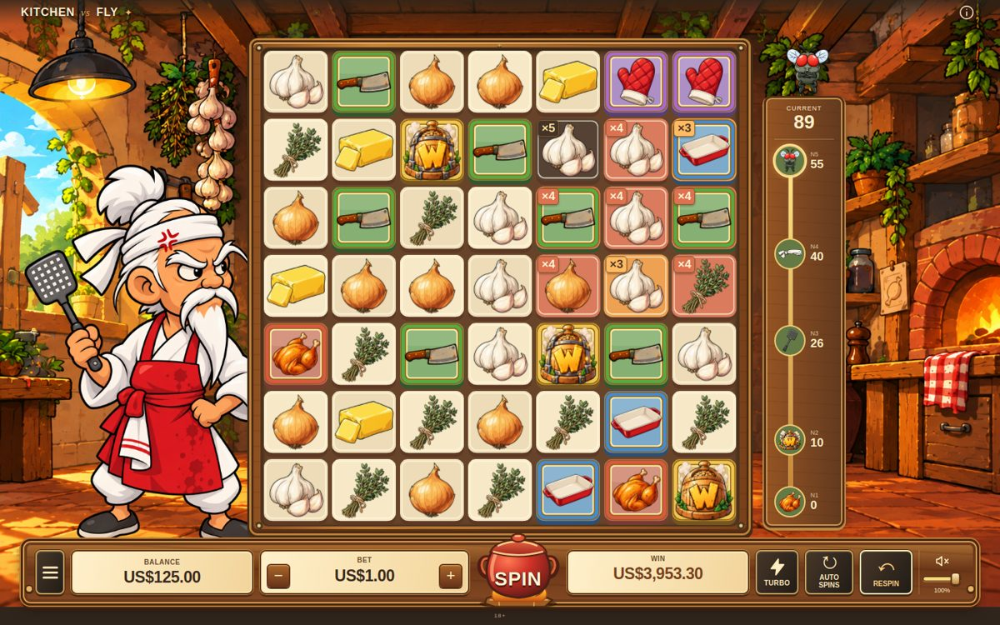
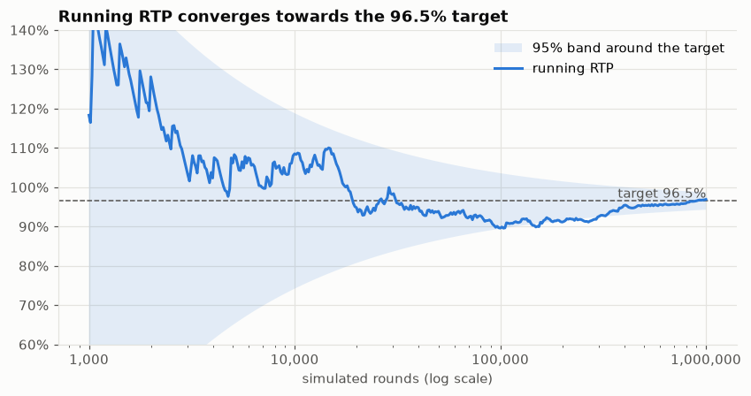
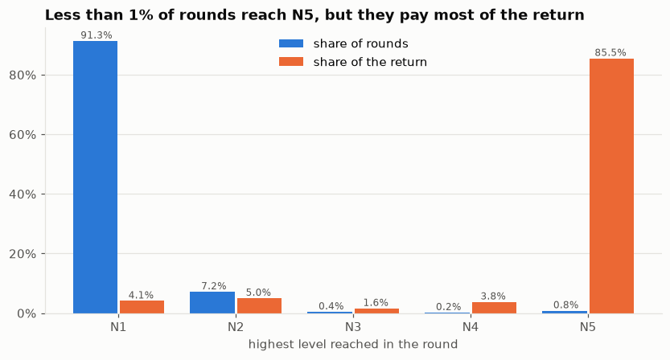
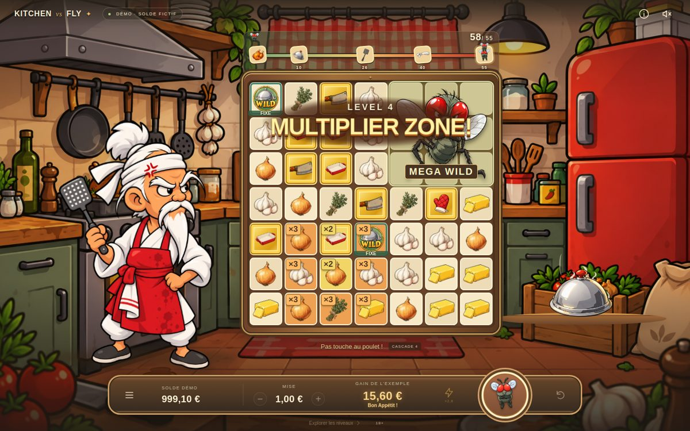

# Kitchen vs Fly: Monte Carlo calibration of a cluster-pays game

[](https://github.com/tvallot/slot-math-monte-carlo/actions/workflows/tests.yml)

The math engine of **Kitchen vs Fly**, a slot-style game I am designing: a 7 × 7 grid where groups of identical symbols pay, explode and cascade, and where every win in a round fills a progression meter that unlocks five increasingly powerful levels.

The interesting part is not the game, it is the **probability problem** behind it. Every rule and parameter (symbol weights, paytable, level thresholds, bonus frequency) changes the expected return, and none of it can be computed in closed form. So the game is calibrated by **Monte Carlo simulation**: play millions of rounds, measure, adjust one lever, repeat, until the return to player (RTP) sits on its 96.5 % target, with every simulated round replayed to check it.

<p align="center">
  
</p>

> **Status: work in progress.** The math engine is complete and validated (this repository). The game client (Svelte / PixiJS) is still in development in a separate repository.

## Key results

Final 7 × 7 configuration, 3,000,000 simulated rounds split into 10 independent batches:

| Metric | Value |
|---|---:|
| RTP (target 96.5 %) | **96.50 %**, standard error ≈ 0.65 points |
| Hit rate (rounds with a win) | 32.3 % |
| Final level (N5) reached | 1 round in 117.6 |
| Fly mini-bonus triggered | 1 round in 17.5 |
| Share of the return paid by N5 rounds | ≈ 86 % |
| Replay errors | 0 / 3,000,000 |

The [analysis notebook](notebooks/analysis.ipynb) reproduces these figures on 1,000,000 fresh rounds: confidence interval (normal and bootstrap), how many rounds a reliable estimate needs, the win distribution and where the return comes from.

<p align="center">
  
  
</p>

The [calibration log](docs/calibration.md) tells how the parameters were found, including a bug the simulation caught: enabling the Fly bonus first pushed the RTP to about **146 %**, because its extra wilds were wrongly credited to the progression meter.

## How the game works

- **Grid:** 7 × 7, eight symbols (four low: onion, garlic, butter, herbs; four premium: knife, dish, gloves, roast chicken).
- **Wins:** a cluster of at least 5 identical symbols connected horizontally or vertically pays a multiple of the bet that depends on the symbol and the cluster size.
- **Cascades:** winning symbols are removed, the symbols above fall, new ones fill the gaps, and the board is evaluated again until no cluster is left.
- **Progression:** each removed winning symbol adds one point to a meter. Thresholds at 10, 26, 40 and 55 points unlock the levels below, once each per round. Nothing carries over to the next bet.

| Level | Theme | Mechanic |
|---|---|---|
| N1 | Normal kitchen | Standard clusters and cascades |
| N2 | Protect the chicken | 2 persistent wilds + 2 temporary wilds |
| N3 | Active hunt | All premium symbols on the board turn into one premium type |
| N4 | Determination | A 3 × 3 zone of multipliers (× 2, growing to × 5) + 3 wilds |
| N5 | Boss | A giant fly: a 3 × 3 wild that shrinks to 2 × 2, then 1 × 1, then is defeated, one step per evaluation of the board |

- **Fly mini-bonus:** in about 1 round in 17.5, 2 or 3 wilds land on the board before the first evaluation.
- **Win cap:** 1,000 × the bet.

<p align="center">
  
</p>

## Repository structure

```
kitchen_vs_fly/
├── game_config.py   all parameters: grid, symbol weights, paytable, thresholds, configurations
├── gamestate.py     the round: cascades, progression, N2-N5 features, Fly mini-bonus
├── progression.py   progression meter rules
├── game_events.py   event log of each round (used to replay it and to animate the client)
├── validation.py    deterministic replay of every round + library statistics
├── publication.py   exact lookup-table weights so the published RTP is exactly 96.5 %
├── simulate.py      Monte Carlo runs -> one row per round (data/*.csv.gz)
└── run.py           builds and validates a full library in the SDK's output format
tests/               386 tests: each level and feature, replay, production configuration
notebooks/           analysis of the simulated rounds
docs/                calibration log, screenshots, figures
vendor/math-sdk      Stake Engine math SDK (git submodule, unmodified)
```

The game is built on the [Stake Engine math SDK](https://github.com/StakeEngine/math-sdk) (MIT), included as a submodule pinned to the version the game was validated with. The SDK provides the generic machinery (board, cluster detection, simulation runner, output files); the game rules, features, calibration, validation and analysis are in `kitchen_vs_fly/`.

Code comments cite version tags (`V0.3.x`) and milestone reports from my development log; the key decisions are summarized in [docs/calibration.md](docs/calibration.md).

## Running it

Requires Python 3.12.

```bash
git clone --recursive https://github.com/tvallot/slot-math-monte-carlo.git
cd slot-math-monte-carlo
pip install -r requirements.txt

python -m pytest                                        # 386 tests, about 30 s
python -m kitchen_vs_fly.simulate --sims 1000000        # about 15 min, writes data/rounds_7x7-production.csv.gz
python -m kitchen_vs_fly.simulate --sims 200000 --config 6x6-candidate-a
jupyter notebook notebooks/analysis.ipynb
```

Round *i* is always played with the same random seed, so every run is reproducible.

## Development

Implemented with the help of AI coding agents (Codex, Claude). The game design, the calibration choices and the validation strategy are mine.
